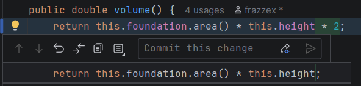
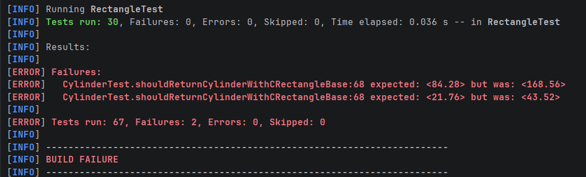
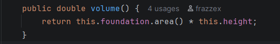
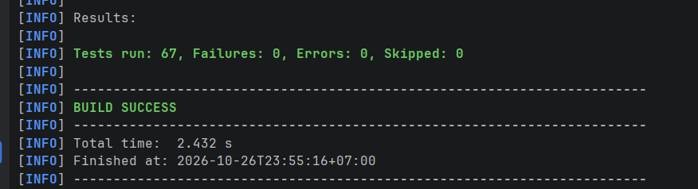

# Студент
**ФИО:** Толоконников Артемий Андреевич

**Группа:** ФИТ-251

## Формат строки
Каждая фигура записывается на отдельной строке по следующему шаблону:
`<Тип фигуры>: <Параметры через пробел>`

### Обозначение типов и параметров:
1. **Круг (`Circle`)**:
    - Формат: `Circle: <radius>`
    - Пример: `Circle: 10.0`
2. **Прямоугольник (`Rectangle`)**:
    - Формат: `Rectangle: <sideA> <sideB>`
    - Пример: `Rectangle: 8.0 14.0`

### Поведение при обработке ошибок:
При обнаружении некорректной строки выбрасывается `InvalidRecordException` с указанием номера строки и причины. Загрузка файла полностью **отклоняется**, а ранее прочитанные фигуры уничтожаются вместе с локальным объектом списка `figures`.

----

## Выполнение 5 задания

В качестве примера был взят метод ``volume`` класса ``Cylinder``.
В формулу подсчета объема было добавлено умножение конечного результата на 2. 

Затем, были проведены тесты программы. В результате, из-за изменения логики подсчета объема, не все тесты удалось пройти.

Затем, код метода ``volume`` был возвращён к исходному.

После этого все тесты были успешно пройдены.

